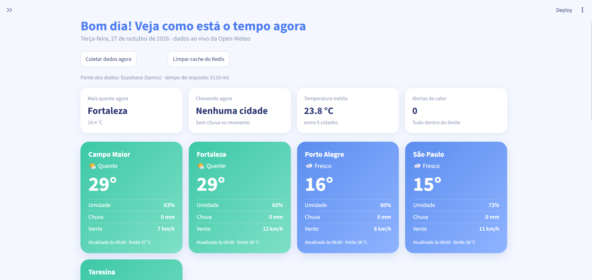
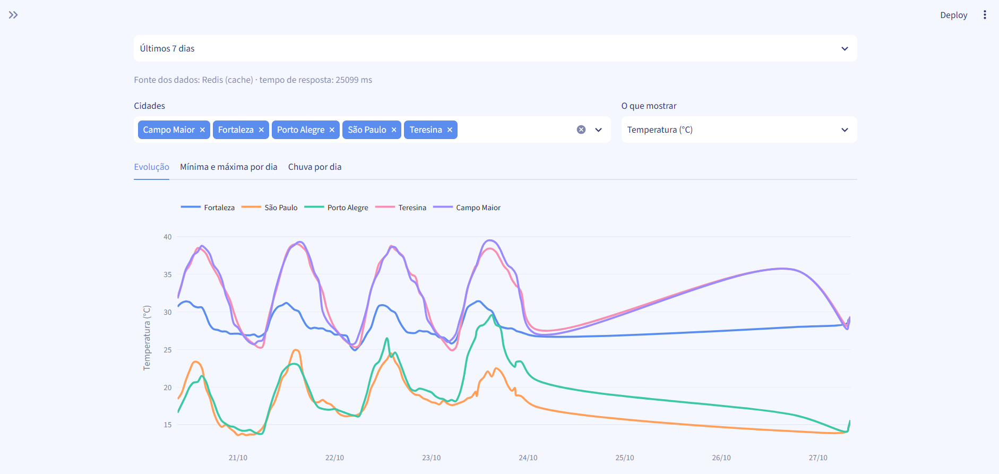
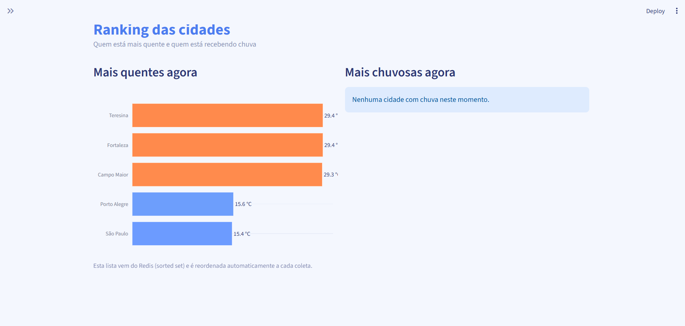
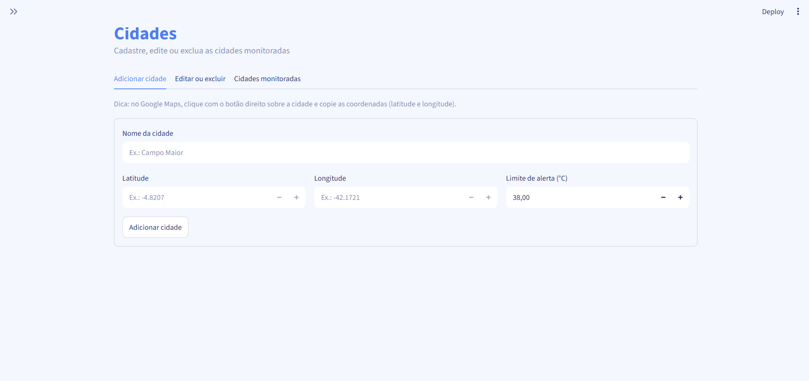

# Monitor de Clima

Dashboard de monitoramento do clima em tempo real, com dados guardados no **Supabase**, cache e ranking no **Redis** e interface gráfica em **Streamlit**.

Trabalho prático individual: Integração com Supabase e Redis.
Autora: Pamella Roberta dos Santos Silva, Engenharia de Software, UNIFSA.

---

## O problema que o projeto resolve

Acompanhar o clima de várias cidades ao mesmo tempo normalmente exige abrir sites diferentes, um para cada cidade, e não deixa nenhum histórico para comparar. O Monitor de Clima reúne tudo em um só painel: mostra como está o tempo agora em cada cidade monitorada, guarda as leituras ao longo dos dias, avisa quando a temperatura passa de um limite definido pelo usuário e permite comparar as cidades de forma visual, mesmo para quem não entende de dados.

## Objetivo e principais funcionalidades

O objetivo é demonstrar, na prática, a integração entre uma interface gráfica, um banco de dados relacional (Supabase) e um banco em memória (Redis), cada um com um papel claro.

- **Painel ao vivo:** cartões coloridos por temperatura, com umidade, chuva e vento de cada cidade, e quatro indicadores no topo (cidade mais quente, onde está chovendo, temperatura média e alertas de calor).
- **Alertas:** cada cidade tem um limite de temperatura configurável; quando ele é ultrapassado, o cartão mostra o selo "Acima do limite".
- **Mapa:** mostra as cidades coloridas pela temperatura; ao escolher uma cidade, o mapa aproxima e exibe os detalhes dela.
- **Histórico:** gráficos de evolução ao longo do tempo, mínima e máxima por dia e chuva por dia, com filtro de cidades, variável e período.
- **Ranking:** cidades mais quentes e mais chuvosas, lidas direto do Redis.
- **Gestão de cidades:** cadastrar, editar e excluir cidades pela tela, com validação (por exemplo, coordenadas zeradas são recusadas). Ao cadastrar, o sistema já busca 7 dias de histórico da cidade.
- **Coleta de dados:** botão "Coletar dados agora" e um script de coleta automática a cada 15 minutos.
- **Estatísticas do cache:** a barra lateral mostra, ao vivo, quantas consultas vieram do Redis e quantas foram ao banco.

## Capturas de tela

| Painel | Histórico |
|---|---|
|  |  |

| Ranking | Cidades |
|---|---|
|  |  |

## Tecnologias utilizadas

| Tecnologia | Para que serve no projeto |
|---|---|
| Python | Linguagem de todo o projeto |
| Streamlit | Interface gráfica (telas) |
| Plotly | Gráficos e mapa |
| Pandas | Organização e resumo dos dados do histórico |
| Supabase (PostgreSQL) | Armazenamento permanente das cidades e das leituras |
| Redis (Redis Cloud) | Cache, ranking e contadores em memória |
| Open-Meteo (API) | Fonte dos dados de clima (gratuita, sem chave de acesso) |

## Como o sistema funciona

```
   Open-Meteo (API)
          |
          |  clima atual e histórico
          v
   coletor.py / carga_historica.py
          |
          |  grava as leituras (UPSERT)         atualiza o ranking e
          v                                      apaga o cache
   Supabase (PostgreSQL)  <------------------->  Redis
          ^                  servicos.py              ^
          |                                           |
          +-------------------+-----------------------+
                              |
                           app.py (Streamlit)
                              |
                         telas do usuário
```

1. O coletor busca o clima na Open-Meteo e **grava no Supabase**.
2. Logo depois, ele **atualiza o ranking no Redis** e **apaga o cache**, que ficou velho.
3. Quando o usuário abre o painel, o `servicos.py` **pergunta primeiro ao Redis**. Se o dado estiver lá, devolve na hora; se não, busca no Supabase, guarda no Redis e devolve.

## Integração com o Supabase

O Supabase é o banco **permanente** do projeto. Tudo o que não pode ser perdido fica nele.

**Tabelas** (o SQL completo está em [`banco.sql`](banco.sql)):

- `cidades`: nome (único), latitude, longitude, limite de alerta e se a cidade está ativa.
- `leituras`: temperatura, umidade, chuva, vento e horário de cada leitura, ligada a uma cidade. A combinação cidade + horário é única, o que permite usar UPSERT sem duplicar dados. Ao excluir uma cidade, as leituras dela são apagadas junto (`on delete cascade`).
- `ultimas_leituras` (view): devolve a leitura mais recente de cada cidade, usando `DISTINCT ON`. Assim o painel faz 2 consultas em vez de uma por cidade.

**Como a aplicação usa o Supabase** (biblioteca `supabase-py`, no arquivo `servicos.py`):

- **Consultar:** lista de cidades, última leitura de cada uma e histórico (com paginação, porque o Supabase devolve no máximo 1000 linhas por consulta e o histórico de 7 dias passa disso).
- **Inserir e atualizar:** cadastro e edição de cidades; gravação das leituras com UPSERT.
- **Excluir:** exclusão de cidades, com remoção em cascata das leituras.
- **Segurança:** o RLS (Row Level Security) está ligado nas tabelas, então as chaves públicas não têm acesso. A aplicação usa a chave *secret* apenas no servidor, lida de variável de ambiente.

**Funcionalidades práticas que usam os dados guardados:** o histórico e seus gráficos, a mínima e a máxima por dia, o total de chuva por dia, os alertas de calor e o mapa.

## Onde e como o Redis foi utilizado, e por que

### O problema que motivou o uso

Para montar o painel, a aplicação precisa consultar o Supabase pela internet, o que leva algum tempo. E essa consulta se repete a cada clique, embora os dados só mudem quando acontece uma coleta (a cada 15 minutos). Ou seja, o app gastaria tempo e consultas ao banco para obter, várias vezes, exatamente o mesmo resultado.

### O que foi feito

| Uso no projeto | Chave no Redis | Estrutura | Comandos | Validade |
|---|---|---|---|---|
| Cache do painel | `painel:v2` | String (JSON) | `GET`, `SET ... EX` | 10 minutos |
| Cache do histórico | `historico:<período>` | String (JSON) | `GET`, `SET ... EX` | 5 minutos |
| Ranking de temperatura | `ranking:temperatura` | Sorted set | `ZADD`, `ZREVRANGE`, `ZREM` | sem expiração |
| Ranking de chuva | `ranking:chuva` | Sorted set | `ZADD`, `ZREVRANGE`, `ZREM` | sem expiração |
| Contadores do cache | `stats:cache_hits`, `stats:cache_miss` | Número | `INCR`, `GET` (em pipeline) | sem expiração |

**Cache (padrão cache-aside).** A função `obter_painel()` consulta o Redis antes do Supabase. Se encontra o dado (*hit*), devolve em milissegundos. Se não encontra (*miss*), busca no Supabase, guarda o resultado no Redis com prazo de validade (TTL) e devolve. O mesmo vale para o histórico, em `obter_historico()`.

**Invalidação do cache.** Sempre que os dados mudam (nova coleta, cidade criada, editada ou excluída), o cache é apagado por `invalidar_cache()`. Assim o painel nunca mostra informação desatualizada por mais tempo do que o necessário.

**Ranking (sorted set).** Cada cidade é um item do conjunto, e a temperatura (ou a chuva) é a pontuação. O Redis mantém tudo ordenado sozinho, então a tela de ranking só lê a lista pronta, sem consultar o Supabase e sem ordenar nada no código.

**Contadores.** A cada consulta, o sistema soma 1 em `stats:cache_hits` ou `stats:cache_miss` com `INCR`, que é uma operação atômica. A barra lateral mostra esses números e a taxa de acerto do cache. Os contadores são gravados e lidos em uma única ida ao Redis (*pipeline*), para economizar tempo de rede.

### Benefícios

- **Velocidade:** a leitura vinda do Redis é muito mais rápida que a do Supabase (veja a medição abaixo).
- **Menos carga no banco:** consultas repetidas não chegam ao Supabase, o que importa porque os planos gratuitos têm limites de uso.
- **Ranking sem custo de ordenação:** o sorted set já entrega a lista ordenada.
- **Dados sempre coerentes:** o TTL e a invalidação garantem que o cache não fique velho.

### Por que o Redis, e não só uma variável no Python

Uma variável em memória do Python some quando o aplicativo reinicia e não é compartilhada entre processos. O Redis resolve isso e ainda oferece recursos prontos que este projeto aproveita: expiração automática (TTL), conjuntos ordenados (sorted sets) e contadores atômicos.

### Medição

Tempos observados na tela do painel ("Fonte dos dados"):

| Origem | Tempo de resposta |
|---|---|
| Supabase (banco) | 2300 ms |
| Redis (cache) | 200 ms |

> O Redis Cloud e o Supabase usados no desenvolvimento ficam em servidores nos Estados Unidos, então parte desses tempos é a distância da rede. Mesmo assim, a diferença entre as duas origens é clara.

### Como ver o Redis funcionando

1. Abra o **Painel** e observe a fonte no topo. Clique em outra tela e volte: a fonte passa a ser **Redis (cache)**, com tempo menor.
2. Clique em **Limpar cache do Redis**: a próxima consulta mostra **Supabase (banco)**, mais lenta, e recria o cache.
3. Clique em **Coletar dados agora**: o dado novo vai para o Supabase, o ranking é atualizado e o cache é apagado.
4. Acompanhe na barra lateral os contadores **Do cache** e **Do banco**.
5. Na tela **Ranking**, veja as listas vindas do sorted set do Redis.

## Estrutura do projeto

```
monitor-clima/
├── app.py               # Interface gráfica (telas em Streamlit)
├── servicos.py          # Acesso ao Supabase e ao Redis (cache, ranking, cidades)
├── coletor.py           # Busca o clima atual na API e grava no Supabase
├── coletor_loop.py      # Repete a coleta a cada 15 minutos
├── carga_historica.py   # Carrega 7 dias de histórico de uma vez
├── banco.sql            # Estrutura do banco (tabelas, view e cidades iniciais)
├── requirements.txt     # Bibliotecas Python necessárias
├── .env.example         # Modelo das variáveis de ambiente
├── .streamlit/
│   └── config.toml      # Tema claro do Streamlit
└── docs/                # Capturas de tela usadas neste README
```

## Instalação, configuração e execução

### Pré-requisitos

- Python 3.10 ou superior
- Uma conta gratuita no [Supabase](https://supabase.com)
- Uma conta gratuita no [Redis Cloud](https://redis.io/try-free)

### 1. Baixar o projeto e instalar as bibliotecas

```bash
git clone [link-do-repositorio](https://github.com/PamellaRob/monitor-clima.git)
cd monitor-clima
python -m venv venv
```

Ative o ambiente virtual:

- Windows (PowerShell): `.\venv\Scripts\Activate.ps1`
- Linux/Mac: `source venv/bin/activate`

Instale as dependências:

```bash
pip install -r requirements.txt
```

### 2. Configurar o Supabase

1. Crie um novo projeto no Supabase.
2. Abra o **SQL Editor**, cole o conteúdo de [`banco.sql`](banco.sql) e execute (se aparecer o aviso sobre RLS, escolha *Run and enable RLS*).
3. Em **Project Settings > API Keys**, copie a **Project URL** e a chave **secret**.

### 3. Configurar o Redis

1. No Redis Cloud, crie um banco de dados gratuito.
2. Anote o **host**, a **porta** e a **senha** do usuário `default`.

### 4. Variáveis de ambiente

Copie o modelo e preencha com os seus dados:

```bash
cp .env.example .env      # no Windows: copy .env.example .env
```

Edite o `.env` com a URL e a chave do Supabase e com o host, a porta e a senha do Redis. **Não envie o `.env` ao GitHub**: ele já está no `.gitignore`.

### 5. Carregar os primeiros dados

```bash
python carga_historica.py     # traz 7 dias de histórico das cidades cadastradas
python coletor.py             # grava a leitura atual
```

### 6. Rodar a aplicação

```bash
streamlit run app.py
```

O navegador abre em `http://localhost:8501`.

### 7. (Opcional) Coleta automática

Em um segundo terminal, com o ambiente virtual ativo:

```bash
python coletor_loop.py
```

Ele coleta o clima a cada 15 minutos. Pare com `Ctrl + C`.

## Observações

- O arquivo `.env` contém chaves privadas e não faz parte do repositório.
- A chave *secret* do Supabase dá acesso total ao banco e deve ficar apenas no servidor da aplicação, nunca em código público.
- Os dados de clima vêm da [Open-Meteo](https://open-meteo.com), que é gratuita para uso não comercial.
